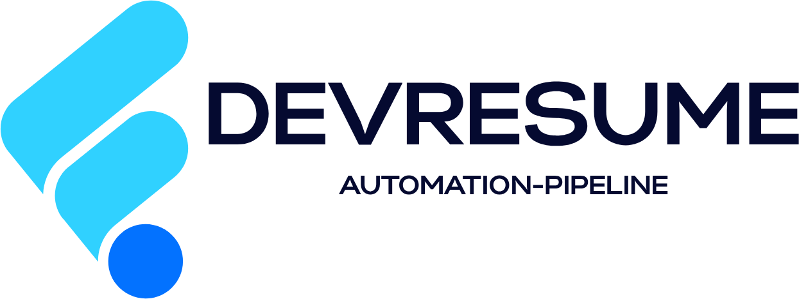
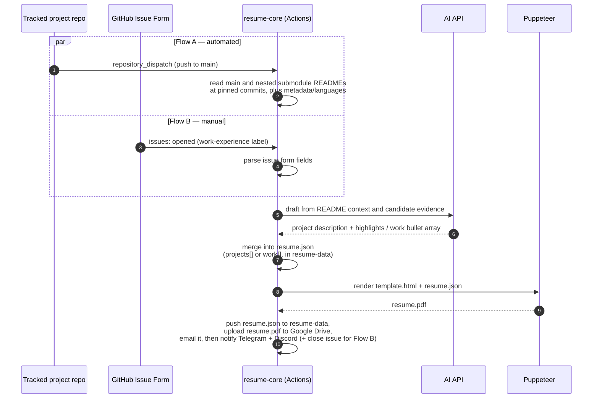
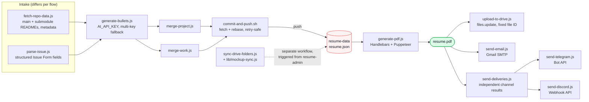

<div align="center">



### The pipeline — data, template, PDF renderer, and every GitHub Actions workflow.


[](https://github.com/ChamathDilshanC/resume-core/actions/workflows/update-resume.yml)
[](https://github.com/ChamathDilshanC/resume-core/actions/workflows/update-work-experience.yml)

</div>

---

An event-driven, zero-backend pipeline that keeps a Software Engineering resume
up to date automatically. Pushes to tagged project repositories and GitHub
Issue Form submissions both flow through GitHub Actions, get rewritten into
professional bullet points by an AI step, and are compiled into `resume.pdf`
via Puppeteer — no server, webhook receiver, or database required.

The raw `resume.json` (contact details, reference phone numbers) lives in a
separate private repo, [`resume-data`](https://github.com/ChamathDilshanC/resume-data),
so it never has to sit in a public repo — this repo checks it out alongside
the pipeline code on every run. The rendered `resume.pdf` is never committed
here either; each run overwrites the same file in Google Drive instead (see
[Google Drive upload](#google-drive-upload) below).

See `architecture.md`, `implementation.md`, and `technologies-used.md` in the
parent repo for the full design rationale.

## Two ways in, one pipeline out



## Component graph

How the scripts under `scripts/` actually call each other within a single
workflow run (both Flow A and Flow B share this same chain from `AI` onward):



## Repository layout

```
template.html                      Handlebars template for the PDF layout
styles.css                         Print-optimized stylesheet (inlined at render time)
generate-pdf.js                    Compiles template + data and renders resume.pdf via Puppeteer
assets/                            Profile photo + brand logo
scripts/
  fetch-repo-data.js               Reads main/submodule READMEs and metadata from GitHub API
  generate-bullets.js              Returns a project description/highlights object or a work bullet array
  merge-project.js                 Appends/updates an entry in resume.json's `projects` array
  merge-work.js                    Appends/updates an entry in resume.json's `work` array
  parse-issue.js                   Parses a submitted Issue Form body into fields
  commit-and-push.sh               Retry-safe commit/push (fetch + rebase on non-fast-forward)
  upload-to-drive.js               Overwrites resume.pdf in Google Drive via the Drive API
  sync-drive-folders.js            Creates/reuses each project's Drive folder and syncs its mockup images
  lib/google-drive.js              Shared Drive client + idempotent find-or-create folder helpers
  lib/project-folder-name.js       Resolves the Drive folder name for a project (repo name, or display name as fallback)
  lib/mockup-sync.js               Pure reconciliation of Drive files <-> resume.json's per-project mockups array
  send-email.js                    Emails resume.pdf (with a Drive link) via Gmail SMTP
  send-telegram.js                 Sends resume.pdf and optional images through the Telegram Bot API
  send-discord.js                  Sends resume.pdf and optional images through a Discord webhook
  send-deliveries.js               Runs both notification channels independently and reports each result
  discover-projects.js             Scans your repos and auto-tags untracked meta-repos with resume-project
.github/workflows/
  update-resume.yml                Flow A: repository_dispatch -> AI -> merge -> PDF -> upload to Drive
  update-work-experience.yml       Flow B: issues:opened -> AI -> merge -> PDF -> upload to Drive -> close issue
  regenerate-pdf.yml               workflow_dispatch: re-render the PDF + re-upload (used by resume-admin)
  discover-projects.yml            Daily + workflow_dispatch: runs discover-projects.js
  sync-drive-mockups.yml           workflow_dispatch: runs sync-drive-folders.js (used by resume-admin)
.github/ISSUE_TEMPLATE/
  work-experience.yml              Structured form for manual work experience entries
notifier-template/notify-resume.yml  Template to copy into each tracked project repo
```

`resume.json` itself lives in the private
[`resume-data`](https://github.com/ChamathDilshanC/resume-data) repo — every
workflow here checks it out into `data/` alongside this repo before touching
it (see **One-time setup** below).

## One-time setup

### 1. `resume-core` repository settings
- **Settings → Actions → General → Workflow permissions**: default
  "Read repository contents" permission is enough — nothing in this repo is
  committed back to it anymore (`resume.pdf` goes to Google Drive instead,
  `resume.json` goes to the separate `resume-data` repo via its own PAT).
- **Settings → Secrets and variables → Actions → Secrets**, add:
  - `AI_API_KEY` — a Google AI Studio (Gemini) API key. Can hold several
    comma-separated keys (e.g. from separate Google accounts); if one hits
    its rate limit (429), the next is tried automatically before failing.
    GitHub Models was retired on 2026-07-30 and is no longer usable.
  - `RESUME_DATA_PAT` — a fine-grained PAT scoped to only the
    [`resume-data`](https://github.com/ChamathDilshanC/resume-data) repo,
    with **Contents: Read and write** permission. Every workflow here checks
    that repo out into `data/` to read/edit `resume.json`, then pushes the
    change back — this has to be a PAT (not the default `GITHUB_TOKEN`)
    because `GITHUB_TOKEN` can only ever touch the repo the workflow runs in.
  - `RESUME_CORE_PAT` *(optional)* — only needed if tracked project repos are
    private; used to read their repo/language data.
  - `GDRIVE_CREDENTIALS` — full JSON key of a Google Cloud service account
    (Drive API enabled). See **Google Drive upload** below.
  - `GDRIVE_FILE_ID` — the Drive file ID `resume.pdf` gets uploaded into. See
    **Google Drive upload** below.
  - `GOOGLE_DRIVE_PROJECTS_ROOT_FOLDER_ID` *(optional — only needed for the
    project mockup gallery)* — the Drive folder ID everything in **Google
    Drive project folders & mockups** below gets created under. Reuses the
    same `GDRIVE_CREDENTIALS` service account, so it must also be shared
    with that service account as Editor.
  - `SMTP_USER` — the Gmail address the resume gets emailed *from*.
  - `SMTP_APP_PASSWORD` — a 16-character
    [Google App Password](https://myaccount.google.com/apppasswords) for
    that account (needs 2-Step Verification enabled first) — not the
    regular Google account password, which Gmail's SMTP rejects.
  - `RECIPIENT_EMAIL` — the address that receives the resume. Can be the
    same address as `SMTP_USER` to just email yourself.
  - `TELEGRAM_BOT_TOKEN` — token issued by Telegram's `@BotFather`.
  - `TELEGRAM_CHAT_ID` — private chat, group or channel ID that receives the
    generated resume.
  - `DISCORD_WEBHOOK_URL` — incoming webhook URL for the destination channel.
- **Settings → Secrets and variables → Actions → Variables** *(optional)*:
  - `AI_MODEL` — override the first Gemini model tried (falls back through
    `gemini-flash-latest` → `gemini-flash-lite-latest` → `gemini-3.6-flash`
    regardless).
  - `DELIVERY_IMAGE_PATHS` — comma- or newline-separated repository-relative
    PNG, JPG, JPEG or WEBP paths to send after/with the PDF. Missing optional
    files are logged and skipped safely.
  - `DISCORD_MAX_UPLOAD_BYTES` — override Discord's conservative default
    20 MiB combined attachment check when the destination server supports a
    larger limit.

### Google Drive upload

Service accounts have **zero storage quota** on a normal (non-Workspace)
Google account, so they can't *create* new files — but they can overwrite
the *content* of a file a real person already owns and shared with them,
which counts against the owner's quota instead. `scripts/upload-to-drive.js`
relies on exactly that (`files.update` on a fixed file ID), so the one-time
setup has to create the placeholder file yourself first:

1. **Google Cloud Console** → create/select a project → enable the
   **Google Drive API**.
2. **IAM & Admin → Service Accounts** → create one (no project roles
   needed) → **Keys** → add key → JSON. That downloaded file's contents are
   the `GDRIVE_CREDENTIALS` secret. Note the service account's email
   (`...@...iam.gserviceaccount.com`).
3. In your own Google Drive, upload any placeholder `resume.pdf` (even a
   blank file) — this makes *you* the owner.
4. Share that file with the service account's email, **Editor** access.
5. Open the file and copy the ID out of its URL
   (`drive.google.com/file/d/`**`THIS_PART`**`/view`) — that's the
   `GDRIVE_FILE_ID` secret.

After that, every pipeline run overwrites the same Drive file in place; the
file's shareable link never changes.

### Google Drive project folders & mockups

Separate from the single `resume.pdf` file above, `sync-drive-mockups.yml`
(`scripts/sync-drive-folders.js`) gives each project in `resume.json` its own
Drive folder to drop mockups/screenshots into:

```
<GOOGLE_DRIVE_PROJECTS_ROOT_FOLDER_ID>/
├── AegisZero/
│   ├── mockups/
│   ├── screenshots/
│   └── assets/
└── DevResume-Automation-Pipeline/
    ├── mockups/
    ├── screenshots/
    └── assets/
```

Setup (one-time):

1. In your own Google Drive, create a folder (e.g. "DevResume Projects") and
   share it with the same service account from **Google Drive upload**
   above, **Editor** access.
2. Copy its ID out of the URL
   (`drive.google.com/drive/folders/`**`THIS_PART`**) — that's the
   `GOOGLE_DRIVE_PROJECTS_ROOT_FOLDER_ID` secret.

Then, from resume-admin's Projects tab (or `workflow_dispatch` here directly,
optionally with a `repo_full_name` input to sync just one project):

1. **Sync Drive Folder** — creates `<repo-name>/mockups`, `/screenshots`,
   `/assets` under the root folder the first time (reusing the folder by ID
   on every later run, so a repo rename never creates a duplicate).
2. Drop PNG/JPG/WEBP images into any of those three subfolders by hand.
3. **Sync Mockups** (same button/workflow) picks up new files, updates
   metadata on ones already known, and flags files removed from Drive as
   `missing` (force-disabled, not deleted from `resume.json`) instead of
   silently dropping them.

Submodules never get their own folder — only entries in `resume.json`'s
`projects` array with `repositoryType` unset or `"MAIN"` are synced (see
**Submodule handling** in `architecture.md`).

### Telegram and Discord delivery

The three resume-producing workflows call `scripts/send-deliveries.js` only
after `resume.pdf` exists. Telegram and Discord are attempted independently:
one channel failing never prevents the other attempt. Each result is logged
separately, and any configured channel that fails still fails the workflow
after both attempts finish. A channel whose credentials are entirely absent is
clearly reported as skipped; a partially configured Telegram channel is an
error rather than a silent skip.

#### Telegram Bot setup

1. Open Telegram's verified `@BotFather`, run `/newbot`, and follow the prompts.
2. Save the issued token as the `TELEGRAM_BOT_TOKEN` GitHub Actions secret.
3. Start a chat with the bot and send it a message. For a group, add the bot to
   the group and send a message there.
4. Open `https://api.telegram.org/bot<TOKEN>/getUpdates` privately and read the
   destination's `message.chat.id`. Group IDs are normally negative. Save only
   that ID as the `TELEGRAM_CHAT_ID` secret; never commit either value.

The integration uses `sendDocument` for the PDF and `sendPhoto` for optional
images. It checks Telegram's 50 MiB document and 10 MiB photo limits before
uploading.

#### Discord webhook setup

1. In Discord, open the destination channel's **Edit Channel → Integrations →
   Webhooks**, create a webhook, and copy its URL.
2. Save the complete URL as the `DISCORD_WEBHOOK_URL` GitHub Actions secret.

The webhook sends `multipart/form-data` with the PDF and any optional images.
It sets `allowed_mentions.parse` to an empty list, so notification text cannot
trigger `@everyone`, users or roles. The default validation allows at most ten
attachments and 20 MiB combined; set `DISCORD_MAX_UPLOAD_BYTES` only when the
destination server has a confirmed higher limit.

#### Manual test and troubleshooting

Open **Actions → Regenerate Resume PDF → Run workflow**. The optional
`delivery_image_paths` input overrides `DELIVERY_IMAGE_PATHS` for that run.
Leaving it empty sends only the generated PDF. This manual workflow uses the
same artifact for Drive, email, Telegram and Discord, and repository
concurrency prevents overlapping resume update runs. None of the delivery
workflows run on `pull_request`, so untrusted pull requests cannot read the
delivery secrets.

If delivery fails:

- Check the individual `[telegram]` and `[discord]` result lines in the job log.
- Confirm all required secrets exist and that the bot/webhook still has access
  to its destination.
- Check PDF/image sizes and optional image paths. Missing optional images are
  warnings; a missing PDF is a hard failure.
- HTTP 429 responses honor `Retry-After`/`retry_after` and retry automatically.
  Network calls have a timeout and fail without retrying an ambiguous upload,
  which avoids duplicate notifications after a connection failure.
- Never paste a token or webhook URL into an issue or workflow log. Rotate the
  credential immediately if it is exposed.

### 2. Each tracked project repository

You almost never need to do this by hand — see **Auto-discovery** below. To
wire a repo up manually anyway:
- Add the `resume-project` topic to the repo (Settings → topic tags).
- Copy `notifier-template/notify-resume.yml` to
  `.github/workflows/notify-resume.yml` in that repo.
- Add a `RESUME_CORE_PAT` secret (fine-grained PAT with permission to send
  `repository_dispatch` events to `resume-core`) — this can be an
  Organization secret if every tracked repo shares the same owner.
- Update the `repository:` field in the copied workflow if the resume-core
  repo doesn't live at `ChamathDilshanC/resume-core`.

**Two topics, two purposes:**
- `resume-project` — this repo is wired up (has the notifier workflow).
  Push all you want while the project is unfinished; nothing happens yet.
- `resume-ready` — add this topic once the project is actually presentable.
  `fetch-repo-data.js` checks for it on every push and skips the AI/PDF
  steps entirely if it's missing, so half-built projects never leak onto
  the resume. Add the topic, then push (or re-run the workflow) to have it
  appear.

### 3. Auto-discovery — never forget to tag a new repo

`discover-projects.yml` runs daily (and on-demand via `workflow_dispatch`)
and does the `resume-project` half of setup for you:

1. Lists every repo you own.
2. For each one that isn't already tagged `resume-project`, checks whether
   it has a `.gitmodules` file at the root — i.e. it's a "main" meta-repo
   that wraps submodules (the `VibeNet-Main` / `RevvUp-Main-Application`
   pattern), not a leaf `frontend`/`backend` repo.
3. If so: adds the `resume-project` topic and commits a ready-to-use
   `notify-resume.yml` into that repo automatically.
4. Skips anything that's already a *nested* submodule of an already-tracked
   repo (e.g. a microservices "platform" repo referenced by a tracked
   monorepo) so multi-level submodule structures never get double-tracked.

This needs `secrets.RESUME_CORE_PAT` set **on `resume-core` itself** with
broad access (list/read all your repos, write topics, write file contents) —
narrower than that and the scan can't see your other repos at all. It still
can't provision the per-tracked-repo `RESUME_CORE_PAT` secret automatically
(that requires an even broader, secrets-write scope) — that one manual step
remains, and the workflow's summary output lists exactly which repos need it.

The only thing you ever do by hand for a brand-new project: add the
`resume-ready` topic once it's actually done.

### 3. Manual work experience entries
- Open a new issue in `resume-core` using the **New Work Experience** form
  (auto-labeled `work-experience`). Submitting it triggers
  `update-work-experience.yml` automatically and closes the issue once done.

## Local development

```bash
npm install
git clone https://github.com/ChamathDilshanC/resume-data.git data
npm run generate        # renders resume.pdf from data/resume.json + template.html
```

`resume.json` isn't in this repo — clone `resume-data` into `./data` (gitignored)
first, or point `RESUME_JSON_PATH` at wherever your local copy lives.

> **Font note:** the template uses Calibri. Locally on Windows this renders
> with real Calibri; the CI workflows install the metric-compatible
> `fonts-crosextra-carlito` package so GitHub's Linux runners produce
> pixel-equivalent pagination — don't remove that step.

To test the helper scripts locally, set the relevant environment variables
(`GITHUB_TOKEN`, `SOURCE_REPO_OWNER`, `SOURCE_REPO_NAME`, `AI_API_KEY`, etc.)
and run them directly, e.g. `node scripts/fetch-repo-data.js`.

For project drafts, run `fetch-repo-data.js` before `generate-bullets.js`: the
ignored `repo-data.json` handoff carries source-labelled README text to the AI.
See [README-based project research](docs/readme-project-research.md) for source
review, recursion, access permissions, context limits and writing rules.
